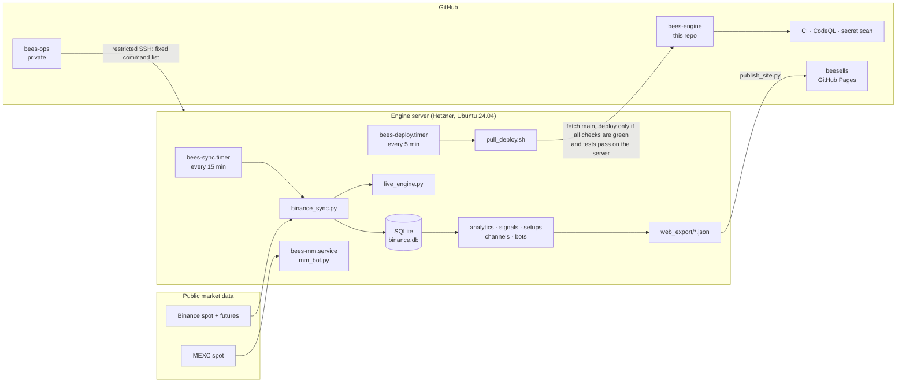

# Bee's Engine

[](https://github.com/beeelahi/bees-engine/actions/workflows/ci.yml)
[](https://github.com/beeelahi/bees-engine/actions/workflows/security.yml)

The data and trading engine behind **[beesells.xyz](https://beesells.xyz)**, a market terminal for every Binance
spot USDT pair. It keeps a complete daily and 4-hour candle history since each coin's listing, derives 50+
indicators and signals, measures every signal against what actually happened next, runs paper-trading bots with
an append-only audit trail, and publishes a static dashboard every 15 minutes.

Everything here is measured, not asserted: each signal, setup and bot on the site shows its own track record,
split into the period it was designed on (up to 2021) and the period it never saw (2022 on), losers included.

> Information only, not financial advice. Bot results are simulated unless explicitly stated otherwise.

---

## What it does

| Area | What runs | Where it shows |
|---|---|---|
| **Market data** | Daily candles for every USDT pair since listing (delisted coins kept), 4-hour candles for 3 years, live prices every 15 minutes, futures funding / open interest / long-short ratio | Screener, pair charts, Overview |
| **Analytics** | 50+ indicators on daily, weekly and monthly bars (EMA, RSI, MACD, ADX, Supertrend, Ichimoku, Bollinger, RVOL, divergences...) | Screener, Signal library |
| **Signal research** | Every signal's forward returns vs. the average pair, before and after 2022 | Signal library, Trade ideas |
| **Leading setups** | RSI-divergence tops and bottoms, daily head-and-shoulders tops, accumulation and bottom-base breakouts, parallel channels (daily + 4h) | Highlights, charts |
| **Paper bots** | Four bots on a $100k paper portfolio, replayed deterministically and integrity-checked every run | Bot, Track record |
| **Live execution** | Spot execution engine with hard risk limits (testnet, shadow and live modes) | Private |
| **Market making** | Post-only grid market maker for MEXC spot | Private |

## Architecture



* **Pull-based delivery.** The server fetches `main` every 5 minutes and deploys a commit only when every GitHub
  check (tests on Python 3.9 and 3.12, lint, CodeQL, secret scan) has passed **and** the test suite passes again on
  the server itself. GitHub holds no credential for the server. Rollback is one command.
* **Standard library only.** The engine needs nothing but `python3`; CI enforces it.
* **Private by construction.** Keys, bot settings, the database and logs exist only on the server and are
  rejected by CI if they are ever committed. API keys must have withdrawals disabled: the code refuses keys
  that can withdraw.

More: [Architecture](docs/ARCHITECTURE.md) · [Operations](docs/OPERATIONS.md) · [Data](docs/DATA.md) ·
[Strategies and evidence](docs/STRATEGIES.md) · [Research log](docs/RESEARCH.md) · [Market making](docs/MARKET_MAKING.md) ·
[Security](SECURITY.md)

## Repository layout

```
bin/        engine (sync, analytics, signals, setups, channels, bots, exporters, publishers, execution)
web/        the dashboard (single-page app, strict CSP, no build step)
deploy/     server provisioning, systemd units, continuous deployment, restricted operations
tests/      unit and end-to-end scenario tests (simulated exchanges; no network, no live data)
research/   the studies behind every published claim, reproducible from database exports
tools/      CI checks (stdlib-only, private files, page syntax, release notes)
docs/       architecture, operations runbook, data dictionary, strategies, research log
```

## Running the tests

```bash
python3 -m unittest discover -s tests -v
```

No dependencies, no network, no API keys. The scenario tests drive the live trading engine and the market
maker against simulated exchanges, including the failure cases (gaps through stops, kill switches, drawdown
halts, the owner's own holdings never being sold).

## Releases

Changes land on `main` through pull requests with green checks; tagged releases (`vX.Y.Z`) publish notes from
[CHANGELOG.md](CHANGELOG.md).

## License

Copyright © 2026 BeencoLabs. All rights reserved. The source is public for transparency; see [LICENSE](LICENSE).
